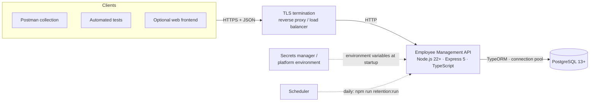
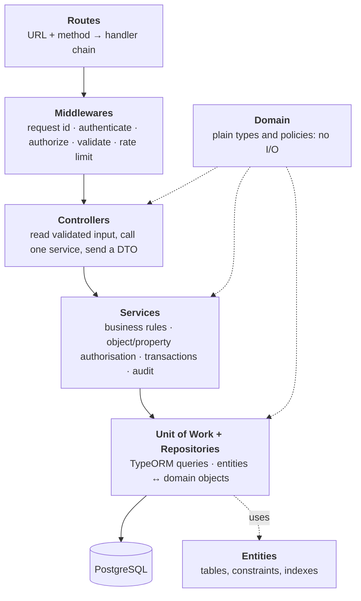
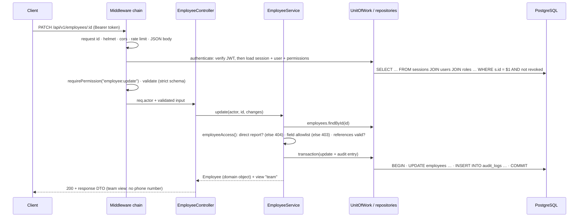
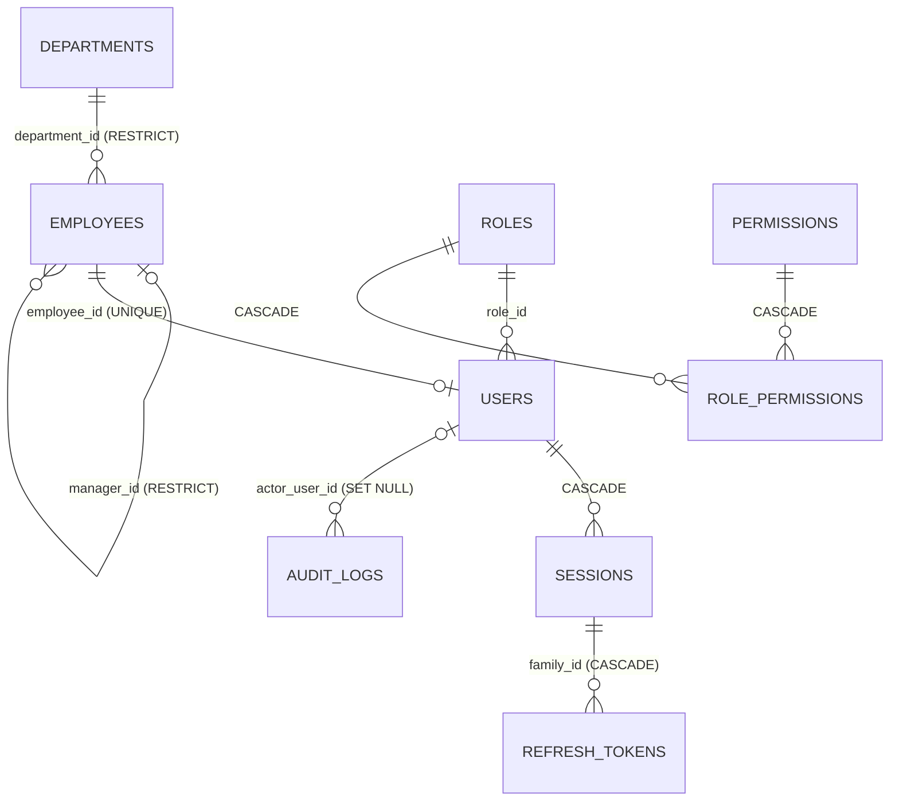

# High-Level Design: Employee Management API

> **Status:** implemented. Every module described here is built and covered by automated
> tests. Decisions are recorded in §10; questions that need the organisation's privacy or
> legal team are in §11 and in [privacy.md](privacy.md).

Companion documents: [Low-Level Design](lld.md) · [Design principles](design-principles.md) ·
[API reference](api.md) · [Security report](security-report.md) · [Privacy](privacy.md)

---

## 1. Purpose and scope

A secure REST API for one organisation to manage **employees**, **departments**, **login
sessions** and **access permissions**. Employee data is personal data, so privacy (data
minimisation, purpose limitation, auditability, retention) is a design input, not an
afterthought.

**In scope:** the endpoints of the assignment (Modules A, B, C) plus role assignment, admin
session revocation and personal-data export; PostgreSQL schema with migrations and seeds;
automated tests; Postman collection; security and privacy documentation.

**Out of scope:** a frontend, single sign-on, multi-factor authentication, email delivery
(invitations, password reset), payroll and salary data, multiple organisations.

## 2. System context

- **Locally:** no proxy; configuration from a git-ignored `.env`; PostgreSQL from `docker compose`.
- **Deployed:** HTTPS terminates at the proxy (`TRUST_PROXY_HOPS` tells the app how many
  proxies to trust for client IPs); secrets come from the secrets manager; each environment
  has its own credentials; the retention job runs on a schedule.

## 3. Architecture style: layered

Required by the assignment (§3 "Data access pattern") and kept strictly:

**Dependency rule:** a layer may use the layers below it, never above it. Only repositories
(and the DataSource in `src/config`) use TypeORM; services see repository methods and domain
objects, never entities or SQL; services know nothing about HTTP. Configuration flows in from
the composition root (`src/container.ts`), so no layer reads it directly. **ESLint enforces
all of this** (`eslint.config.js`): for example, a controller importing a repository fails
`npm run lint`.

**Why layered, and the cost:** each layer can be read and tested on its own; business rules
do not depend on the ORM. The cost is more files per feature. Much larger systems often group
by feature (`modules/employee/{route,service,…}`); this project keeps the layout the
assignment specifies.

## 4. Modules

| Module | Responsibility | Endpoints | Main tables |
|---|---|---|---|
| **Auth and sessions** | Login, access tokens, refresh rotation with reuse detection, logout, logout-all, session list/revoke, password change | `/api/v1/auth/*` (7) | `users`, `sessions`, `refresh_tokens` |
| **Employees** | Create (optionally with an account), list with pagination/filters/search/sort, read, update, deactivate; own profile; personal-data export | `/api/v1/employees/*` (8) | `employees`, `users` |
| **Departments** | Create, list, update | `/api/v1/departments/*` (3) | `departments` |
| **Users (admin)** | Role assignment; revoke all sessions of a user | `/api/v1/users/*` (2) | `users`, `sessions` |
| **Access control** | Roles, permissions, matrix; object- and property-level policies | Used by middleware and services | `roles`, `permissions`, `role_permissions` |
| **Audit** | Append-only record of sensitive actions, written in the same transaction as the change | None public; included in the personal-data export | `audit_logs` |
| **Privacy** | Export; retention job (anonymise expired employees, purge old audit entries) | `GET /employees/me/export`; `npm run retention:run` | all of the above |
| **Platform** | Configuration, DataSource, logging, errors, request ids, Helmet, CORS, rate limits, health | `GET /health` | n/a |

## 5. Request lifecycle

Middleware order, defined once in `src/app.ts`:

1. **request-id**: accept a safe `X-Request-Id` or create one; returned on every response.
2. **request logger**: one line per request: method, path (no query string), status, duration, user id.
3. **helmet**: security headers.
4. **cors**: exact-origin allowlist from `CORS_ORIGINS`; an untrusted `Origin` gets `403`.
5. `GET /health` (before rate limiting and authentication).
6. **general rate limit** per client IP.
7. **JSON only**: a request with a body must be `application/json` (`415`); bodies over 100 KB get `413`.
8. **cookie parser** (refresh-token cookie).
9. `/api/v1`: `Cache-Control: no-store`, then per route: rate limit (auth/bulk endpoints) → `authenticate` → `requirePermission` / `requireRole` → `validateRequest` → controller → service.
10. **not-found** → `404`.
11. **error handler**: the only place that turns errors into responses. Same JSON shape for every error, with the request id; no stack traces, SQL or internal messages.

Example: a manager updating an employee.

## 6. Data model

- UUID primary keys everywhere, generated by PostgreSQL (`gen_random_uuid()`).
- Integrity in the database, not only in code: foreign keys, `UNIQUE (work_email)`, `NOT NULL`,
  `CHECK` constraints (status values, lower-case emails, no self-management, deactivation date ⇔
  inactive status, consistent revocation fields), indexes on searched columns and foreign keys.
  Application checks give friendly errors; the constraint is the final authority (it also
  catches two requests racing each other).
- Every constraint is named in the entity. Repositories translate violations to API errors by
  name (`23505` → 409, `23503`/`23514` → 422).
- `sessions` is added to the assignment's table list: one row per login = one refresh-token family.
- Deactivated employees are kept (status `inactive`, `deactivated_at`) until the retention job
  anonymises them (`anonymised_at`).

## 7. Security architecture

| Concern | Design |
|---|---|
| **Passwords** | Argon2id (OWASP minimum: 19 MiB, t=2, p=1). New passwords: 12–128 characters. Never logged or returned; the column is `select: false`. |
| **Login** | Same `401 INVALID_CREDENTIALS` for an unknown email, a wrong password or a disabled account; a dummy hash check keeps timing similar. Failed attempts rate-limited per IP. |
| **Access token** | HS256 JWT, lifetime `JWT_ACCESS_TTL` (max 1h). Verification pins the algorithm and checks signature, `exp`, `iss`, `aud`. Claims: `sub` (user id), `sid` (session id), `jti`. No personal data, no role. |
| **Refresh token** | 256 random bits, opaque. Only its SHA-256 hash is stored. Rotated on every use (row locked, so concurrent refreshes queue). Reuse of a rotated or revoked token revokes the whole family (session) and is audited. |
| **Revocation** | `authenticate` checks the session and the account on every request, so logout, logout-all, session revocation, password change, role change and deactivation take effect immediately. Cost: one indexed query per request. |
| **Refresh transport** | `HttpOnly`, `Secure` (production), `SameSite=Strict` cookie, `Path=/api/v1/auth`. CSRF: SameSite=Strict plus the CORS allowlist rejecting untrusted origins. Access tokens are returned in the body and should be kept in memory, not `localStorage`. |
| **Authorisation, function level** | `requirePermission(...)` on every protected route, `requireRole('admin')` on `/users`. Deny by default. |
| **Authorisation, object level** | `employeeAccess()`: everyone (admin/HR), direct reports (manager), or self. Out of scope → `404`, indistinguishable from "does not exist". Managers' lists are filtered in the SQL query itself. |
| **Authorisation, property level** | Strict request schemas (unknown fields → 400, so `role`/`salary` cannot be mass-assigned); per-role editable-field lists in the service (→ 403); per-view response DTOs (managers do not see phone numbers; lists never do). |
| **Abuse** | General, login, refresh, password-change and bulk (list/export) rate limits; 100 KB body limit; page size ≤ 100; allowlisted sort fields. |
| **Transport and headers** | HTTPS in deployed environments; Helmet headers; `Cache-Control: no-store` on the API. |
| **Configuration** | Validated at startup; secrets only from the environment; startup refuses unreachable or un-migrated databases. |

The OWASP API Security Top 10 mapping and the attack scenarios are in the [security report](security-report.md).

## 8. Cross-cutting concerns

- **Configuration:** `src/config/env.ts` is the only reader of `process.env` (lint-enforced); values are passed down from the composition root.
- **Errors:** `AppError` hierarchy (400, 401, 403, 404, 409, 413, 415, 422, 429); one error handler; generic 500 for anything unexpected (logged in full with the request id).
- **Logging:** structured JSON (pino); redaction of passwords, tokens, cookies and hashes; errors reduced to type/message/stack; no request bodies, no query strings.
- **Auditing:** role changes, deactivation, session revocation, refresh-token reuse, password changes, employee/department changes, profile exports. Field names only, never values.
- **Privacy:** data inventory, per-role field visibility, export, configurable retention: see [privacy.md](privacy.md).

## 9. Deployment and non-functional requirements

| Quality | How it is met |
|---|---|
| Security | §7; OWASP API Top 10 controls; HTTPS in deployed environments |
| Privacy | Minimisation, per-role views, export, retention job, audit trail |
| Reliability | Fail fast on bad config, unreachable DB or pending migrations; graceful shutdown drains HTTP then closes the pool |
| Maintainability | Strict TypeScript; lint-enforced layers; explicit constraint names; generated + reviewed migrations |
| Testability | `createApp(deps)` without a port; services built by `createServices`; 119 tests on a real database |
| Resource limits | Body ≤ 100 KB, page size ≤ 100, rate limits from configuration, pool size from configuration |
| Operability | `GET /health`; request ids in logs, responses and audit entries |
| Scalability limits | Rate-limit counters are in memory (per instance). Several instances need a shared store such as Redis. |

## 10. Decision log

| # | Decision | Status | Reason |
|---|---|---|---|
| D1 | Layered architecture, folder layout from the assignment (+ `entities/`, `container.ts`) | Accepted | Required; testable layers |
| D2 | TypeScript (strict), native ES modules, Node.js 22+; TypeScript pinned to 6.0.x | Accepted | Type safety; `typescript-eslint` does not support TypeScript 7 yet |
| D3 | `zod` for configuration and request validation, strict object schemas | Accepted | One library; typed output; unknown fields rejected |
| D4 | Validate configuration at startup; refuse to start on any problem | Accepted | Fail fast; secrets never printed |
| D5 | Layer boundaries, TypeORM confinement and single config reader enforced by ESLint | Accepted | Architecture checked by a tool |
| D6 | **TypeORM 1.x** with decorator entities, explicit column types and named constraints; migrations generated then reviewed; `synchronize: false` | Accepted | Course requirement; demonstrates migrations, constraints and transactions; parity test catches drift |
| D7 | Unit of Work wrapping TypeORM transactions; repositories map entities → domain objects | Accepted | Services stay ORM-free; atomic multi-step writes |
| D8 | Argon2id with OWASP minimum parameters | Accepted | OWASP's first recommendation |
| D9 | HS256 JWT access tokens (algorithm pinned; `iss`, `aud`, `exp` checked) via `jose` | Accepted | Matches the single shared secret in the configuration |
| D10 | Opaque refresh tokens in an HttpOnly cookie; SHA-256 hash stored; rotation with family revocation on reuse | Accepted | Not readable by JavaScript; theft is detectable |
| D11 | `sessions` table and a per-request session check | Accepted | Immediate revocation |
| D12 | Out-of-scope records return `404` | Accepted | Do not reveal existence |
| D13 | Manual dependency injection at a composition root | Accepted | Explicit wiring; no framework to learn |
| D14 | pino structured logs with redaction; no bodies or query strings logged | Accepted | Logs are a common leak of personal data and tokens |
| D15 | Vitest + Supertest against a real PostgreSQL test database | Accepted | Constraints and transactions need a real database |
| D16 | Deactivation instead of deletion; anonymisation by a scheduled retention job | Accepted | History preserved; erasure after the retention period |

## 11. Decisions on the assignment's open points

Taken for this implementation. Confirm with the trainer, and with a privacy/legal team where marked ⚖.

| Question | Decision |
|---|---|
| Salary | **Not stored** (not in the required field list; data minimisation). Requests containing `salary` are rejected like any unknown field. |
| How a new employee gets credentials | HR/admin may create the login account with the employee, choosing a role they are allowed to grant and an initial password; the employee should change it with `/auth/change-password`. A forced change on first login and email invitations are **not** implemented (see the security report). |
| Role assignment endpoint | `PATCH /api/v1/users/:id/role`, admin only, audited, revokes the user's sessions. |
| Personal-data export endpoint | `GET /api/v1/employees/me/export`. |
| Manager scope | Direct reports only (not the whole reporting tree). |
| May an employee have no department? | No: `department_id` is `NOT NULL`. |
| Can HR create HR accounts? | No: HR may grant `employee` and `manager` only. |
| Retention periods ⚖ | Configurable (`AUDIT_LOG_RETENTION_DAYS`, `INACTIVE_EMPLOYEE_RETENTION_DAYS`); the defaults (365 / 2190 days) are placeholders. |
| Lawful basis, notices, erasure exceptions ⚖ | Not decidable in code: see [privacy.md §8](privacy.md#8-questions-for-the-privacy-and-legal-team). |
