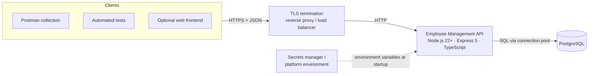
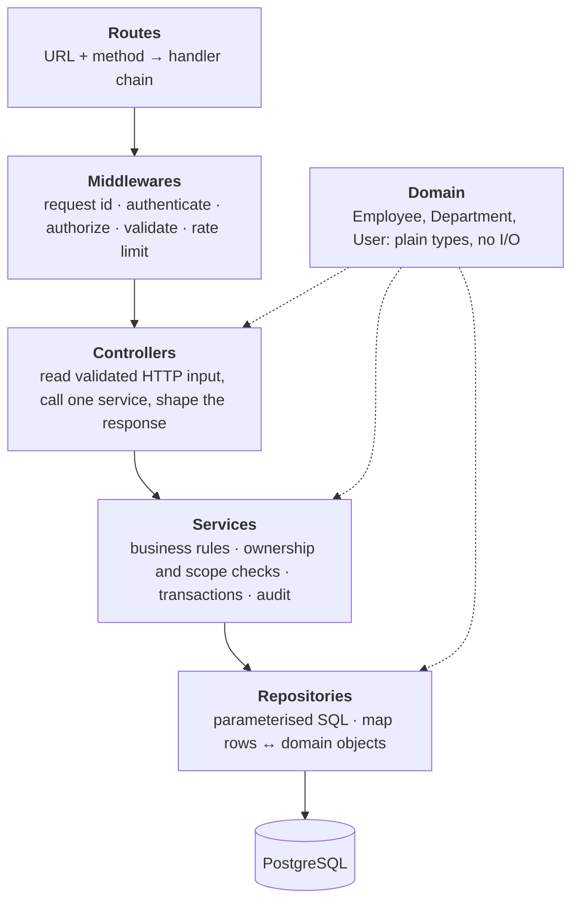
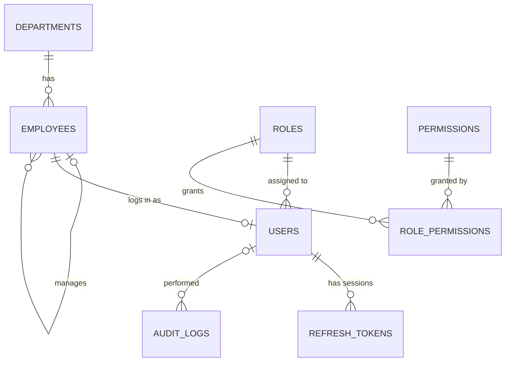

# High-Level Design: Employee Management API

> **Status:** living document. Phase 0 (project setup and configuration) is built.
> Everything else describes the target design that later phases implement.
> Decisions are marked **Accepted** (built, or fixed by the assignment) or **Proposed**
> (the intended approach, to confirm when that phase starts). See §10 and §11.

Companion documents: [Low-Level Design](lld.md) · [Design principles](design-principles.md)

---

## 1. Purpose and scope

A secure REST API for one organisation to manage **employees**, **departments**,
**login sessions** and **access permissions**. Employee data is personal data, so
privacy (GDPR data minimisation, purpose limitation, auditability) is a design input,
not an afterthought.

**In scope:** the endpoints in the assignment (Modules A, B, C), PostgreSQL schema with
migrations and seeds, automated tests, a Postman collection, and security/privacy documentation.

**Out of scope:** a frontend (optional), single sign-on, email delivery (invitations,
password-reset mail), payroll processing, multiple organisations (multi-tenancy).

## 2. System context



- **Locally:** no proxy; configuration comes from a git-ignored `.env` file.
- **Deployed:** HTTPS terminates at the proxy, secrets come from the platform's secrets
  manager, and each environment (test, staging, production) has its own credentials.

## 3. Architecture style: layered

Required by the assignment (§3 "Data access pattern") and kept strictly:



**Dependency rule:** a layer may use the layers below it, never above it, and only
repositories talk to PostgreSQL. Services know nothing about HTTP (no `req`/`res`), so
the same rule can be called from a route, a script or a test. **This rule is enforced
by ESLint** (`eslint.config.js`): a controller that imports a repository fails `npm run lint`.

**Why layered (and the cost):** each layer can be read and tested on its own, and
persistence can change without touching business rules. The cost is more files per
feature. Much larger systems often group by feature (`modules/employee/{route,service,…}`);
this project follows the folder layout the assignment specifies.

## 4. Modules

| Module | Responsibility | Endpoints | Main tables |
|---|---|---|---|
| **Auth and sessions** | Login, access-token issue, refresh-token rotation and reuse detection, logout, logout-all, session listing and revocation, password change | `/api/v1/auth/*` (7) | `users`, `refresh_tokens` |
| **Employees** | Create, read, update, deactivate (never hard-delete); list with pagination, filters, search and allowlisted sorting; own profile (`/me`); export own data | `/api/v1/employees/*` (7, plus export, §11) | `employees` |
| **Departments** | Create, list, update | `/api/v1/departments/*` (3) | `departments` |
| **Access control** | Roles, permissions, role-to-permission mapping, ownership and manager-scope checks | No endpoints of its own; used by middleware and services | `roles`, `permissions`, `role_permissions` |
| **Audit** | Append-only record of sensitive actions (role change, deactivation, session revocation, access to restricted data) | None public | `audit_logs` |
| **Platform** (cross-cutting) | Configuration, database pool, logging, errors, request ids, security headers, CORS, rate limits, health | `GET /health` | n/a |

## 5. Request lifecycle

Middleware runs in this order, defined once in `src/app.ts`:

1. **request-id**: accept or create `X-Request-Id`, echo it on every response, attach it to logs and errors.
2. **helmet**: security headers.
3. **cors**: exact-origin allowlist from `CORS_ORIGINS` (never `*`).
4. **body parsing**: JSON only, size-limited; wrong `Content-Type` is rejected.
5. **rate limiting**: a global limit, plus stricter limits on login, refresh, password change and bulk reads.
6. **route chain**: `authenticate` → `requirePermission(...)` → `validate(schema)` → controller → service.
7. **not-found**: unknown routes → `404`.
8. **error-handler**: the only place that turns errors into HTTP responses. Safe JSON body with the request id; no stack traces or SQL in responses.

Example: a manager updating an employee.

```mermaid
sequenceDiagram
    participant Client
    participant MW as Middleware chain
    participant Ctl as EmployeeController
    participant Svc as EmployeeService
    participant Repo as EmployeeRepository
    participant DB as PostgreSQL

    Client->>MW: PATCH /api/v1/employees/:id (Bearer access token)
    MW->>MW: request id · helmet · cors · body limit · rate limit
    MW->>MW: authenticate: verify JWT signature, exp, iss, aud; session still active
    MW->>MW: requirePermission("employee:update")
    MW->>MW: validate params and body (strict allowlist: unknown fields → 400)
    MW->>Ctl: req.user + validated input
    Ctl->>Svc: updateEmployee(actor, id, changes)
    Svc->>Repo: findById(id)
    Repo->>DB: SELECT … WHERE id = $1
    DB-->>Repo: row
    Repo-->>Svc: Employee (domain object)
    Svc->>Svc: scope check: is this employee in the actor's reporting line? If not → 404
    Svc->>Repo: update + audit entry (one transaction)
    Repo->>DB: BEGIN · UPDATE … · INSERT INTO audit_logs … · COMMIT
    Svc-->>Ctl: updated Employee
    Ctl-->>Client: 200 + response DTO (only the fields this role may see)
```

## 6. Data model (overview)

Columns are defined in the database phase; this shows entities and relationships.



Integrity lives in the database, not only in code: UUID primary keys, foreign keys,
`UNIQUE (work_email)`, `NOT NULL`, `CHECK` constraints (e.g. employment status values,
no self-management), and indexes on searched columns and foreign keys. Application
validation gives friendly errors; the database constraint is the final authority.

## 7. Security architecture

| Concern | Design |
|---|---|
| **Passwords** | Argon2id hashes (Proposed). Never logged, never returned. Generic login error whether or not the account exists. |
| **Access token** | Short-lived JWT (`JWT_ACCESS_TTL`, max 1h). Algorithm pinned on verify; `exp`, `iss`, `aud` checked. Carries user id, role and session id, nothing personal. |
| **Refresh token** | 256-bit random value. Only its SHA-256 hash is stored. Rotated on every use. Reusing an already-rotated token revokes its whole family (session). |
| **Revocation** | `authenticate` checks the token's session and the user's `is_active` flag on each request (Proposed), so logout, deactivation and password change take effect immediately, not up to 15 minutes later. Cost: one indexed lookup per request. |
| **Refresh transport** | `HttpOnly`, `Secure` (production), `SameSite=Strict` cookie scoped to `/api/v1/auth` (Proposed). CSRF risk is limited by `SameSite=Strict` plus an `Origin` check on the cookie-using endpoints. |
| **Authorisation, function level** | `requireRole(...)` / `requirePermission(...)` on every protected route. Deny by default. |
| **Authorisation, object level** | Service-level checks: self, reporting line (manager scope), or HR/admin. Out-of-scope records return `404`, not `403`, so their existence is not revealed. |
| **Authorisation, property level** | Strict request schemas per role (unknown fields rejected, so `"role": "admin"` cannot be mass-assigned); response DTOs list exactly which fields each role sees. |
| **Abuse** | Rate limits, body-size limit, page-size cap, validated sort fields. |
| **Configuration** | Validated at startup (built). Secrets only from the environment, never in code or git. |

Each OWASP API Security Top 10 risk is mapped to its control in the security report (a later deliverable).

## 8. Cross-cutting concerns

- **Configuration:** `src/config/env.ts` is the only reader of `process.env` (built, and lint-enforced).
- **Errors:** a small `AppError` hierarchy (`NotFound`, `Forbidden`, `Conflict`, `Validation`, `Unauthorized`). Repositories translate PostgreSQL error codes (e.g. `23505` unique violation) into these, and the central handler maps them to HTTP.
- **Logging:** structured JSON with the request id; passwords, tokens and full employee records are redacted.
- **Auditing:** written in the same transaction as the change it records.
- **Privacy:** data inventory (field → purpose → who may see it → retention → deletion), configurable retention, self-service data export.

## 9. Deployment and non-functional requirements

| Quality | Target |
|---|---|
| Security | OWASP API Top 10 controls (§7); HTTPS in every deployed environment |
| Privacy | Data minimisation; least-privilege field access; retention policy; audit trail |
| Reliability | Fail fast on bad configuration (built); graceful shutdown that drains requests and closes the DB pool (built for HTTP) |
| Maintainability | Strict TypeScript; one responsibility per layer; lint-enforced boundaries |
| Testability | `createApp()` builds the app without opening a port (built); services testable without HTTP |
| Resource limits | Body ≤ 100 KB, page size ≤ 100, rate limits from configuration |
| Operability | `GET /health`; request ids in logs and responses |

## 10. Decision log

| # | Decision | Status | Reason |
|---|---|---|---|
| D1 | Layered architecture, folder layout from assignment §7 | Accepted | Required; testable layers |
| D2 | TypeScript (strict), native ES modules, Node.js 22+ | Accepted | Type safety; current LTS lines |
| D3 | `zod` for validating configuration and requests | Accepted | One library, typed results ("parse, don't validate") |
| D4 | Validate all configuration at startup; refuse to start on any problem | Accepted | Fail fast; secrets never printed |
| D5 | Layer boundaries and the single config reader enforced by ESLint | Accepted | Architecture checked by a tool, not just by review |
| D6 | `pg` with hand-written parameterised SQL and SQL migration files | Proposed | Shows mapping and transactions explicitly; no hidden queries |
| D7 | Argon2id for password hashing | Proposed | OWASP's first recommendation |
| D8 | HS256 JWT, algorithm pinned, `iss`/`aud`/`exp` verified | Proposed | Matches the single shared secret in the assignment's configuration |
| D9 | Refresh token in an `HttpOnly` cookie | Proposed | Not readable by JavaScript (XSS) |
| D10 | Per-request session and `is_active` check | Proposed | Immediate revocation (§7) |
| D11 | Manual dependency injection at a composition root | Proposed | Explicit wiring; no framework to learn |
| D12 | Out-of-scope records return `404` | Proposed | Do not reveal existence |
| D13 | Vitest + Supertest against a real PostgreSQL test database | Proposed | Constraints and transactions need a real database |

## 11. Open questions

To settle with the trainer, or with a privacy/legal team where noted:

1. **Salary:** not in the assignment's employee field list. Proposed: do not store it (data minimisation). Strict request schemas still reject a `salary` field, which covers the mass-assignment test.
2. **Account provisioning:** how does a newly created employee get login credentials (temporary password, invitation)? Email delivery is out of scope.
3. **Role assignment endpoint:** Admin "role assignment" has no endpoint in the list. Proposed: `PATCH /api/v1/users/:id/role` (admin only, audited).
4. **Data export endpoint:** proposed `GET /api/v1/employees/me/export`.
5. **Manager scope:** direct reports only, or the whole reporting tree? Proposed: direct reports.
6. **Department optional?** Proposed: required (`NOT NULL`), as the assignment's default.
7. **Retention periods** for audit logs and for deactivated employees' data: privacy/legal decision; the values will be configurable.
