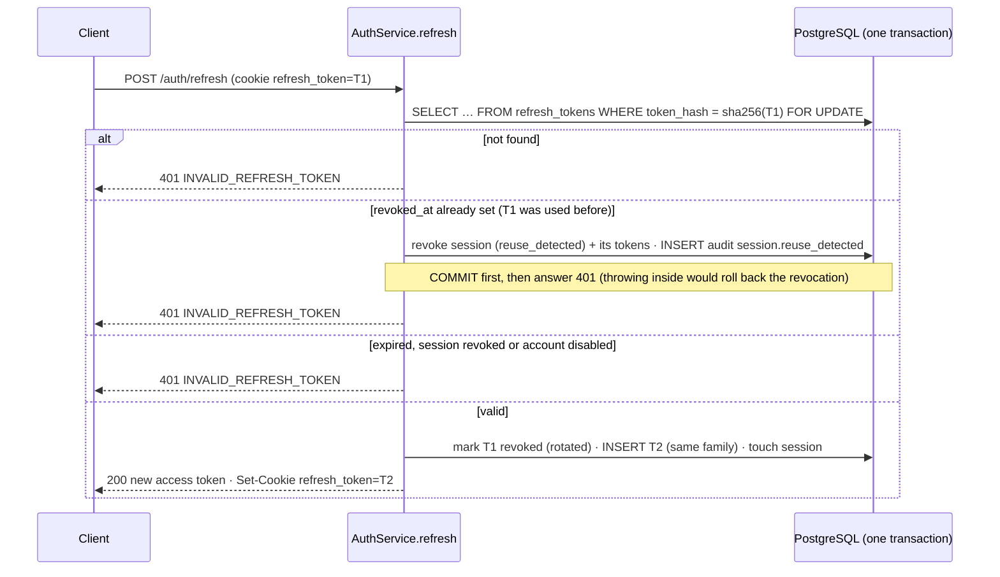

# Low-Level Design: Employee Management API

> **Status:** implemented. Describes how each module is built: interfaces, flows, rules and
> errors. Add a section (template in §13) when you add a module.

Companion documents: [High-Level Design](hld.md) · [Design principles](design-principles.md) ·
[API reference](api.md)

---

## 1. Conventions

### 1.1 Files and naming

| What | Convention | Example |
|---|---|---|
| File names | kebab-case + role suffix | `employee.service.ts`, `refresh-token.repository.ts`, `user.entity.ts` |
| Relative imports | Include the `.ts` extension (rewritten to `.js` on build) | `import { env } from './config/env.ts'` |
| Type-only imports | `import type` | `import type { Request } from 'express'` |
| Classes / types | PascalCase; entities end in `Entity` | `EmployeeService`, `EmployeeEntity`, `Employee` |
| Database objects | snake_case; constraints named `pk_`, `uq_`, `fk_`, `chk_`, `idx_` + table + column | `uq_employees_work_email` |
| Permissions | `resource:action` | `employee:update` |

### 1.2 Layer contracts

| Layer | Receives | Returns | Must NOT |
|---|---|---|---|
| **Route** | n/a (wiring) | n/a | contain logic |
| **Middleware** | `req`, `res`, `next` | `next()` / throws `AppError` | use repositories or TypeORM |
| **Controller** | `getValidated(req, schemas)` + `requireActor(req)` | a response DTO | contain business rules, read `req.body` directly, touch the database |
| **Service** | `Actor` + plain values | domain objects | import Express, TypeORM, entities or config |
| **Repository** | plain values | domain objects or `null` | enforce business rules, concatenate input into SQL |
| **Entity** | n/a | n/a | be returned outside a repository |
| **Domain** | n/a | n/a | do I/O or import anything outside `src/domain` |

### 1.3 Data shapes across the layers

```text
HTTP JSON ──zod──▶ validated input ──▶ Service ──▶ Repository ──TypeORM──▶ Entity (row)
                                                                            │
HTTP JSON ◀──DTO── domain object ◀──── Service ◀── Repository ◀──map────────┘
           (explicit field list)         (no password hash, no persistence details)
```

### 1.4 Errors

- Services throw `AppError` subclasses (`src/errors/app-error.ts`).
- `UnitOfWork.transaction` translates PostgreSQL constraint violations by constraint name (§4.5).
- Express 5 forwards rejected promises from `async` handlers to the error handler, so
  controllers need no `try/catch` (the one exception: the refresh controller clears the cookie on failure).

## 2. Startup and shutdown (`src/server.ts`)

```mermaid
sequenceDiagram
    participant P as Process
    participant Env as config/env.ts
    participant DS as DataSource
    participant App as createApp()
    P->>Env: import (first)
    Env->>Env: dotenv (never overrides real variables) · parseEnv(process.env)
    alt invalid
        Env-->>P: every problem, by name · exit 1
    end
    P->>DS: initialize()
    alt unreachable
        DS-->>P: "Could not connect to the database…" (no URL, no password) · exit 1
    end
    P->>DS: showMigrations()
    alt pending
        DS-->>P: "schema is out of date. Run: npm run db:migrate" · exit 1
    end
    P->>App: createApp({ config, logger, services: createServices(dataSource, config) })
    P->>P: listen(PORT) (EADDRINUSE → exit 1)
    Note over P: SIGINT / SIGTERM
    P->>P: server.close() → dataSource.destroy() → exit 0 (forced exit 1 after 10 s)
```



## 3. Configuration (`src/config/env.ts`)

```ts
export const env: Env;                 // validated and frozen; imported only by entry points
export type Env;                       // typed: PORT is a number, CORS_ORIGINS a string[], …
export function parseEnv(source: Record<string, string | undefined>): Env; // pure; throws ConfigError
export class ConfigError extends Error { readonly problems: readonly string[] }
```

Who imports `env`: `server.ts`, `config/data-source.ts` (TypeORM CLI), `seeds/seed.ts`,
`scripts/run-retention.ts`. Everyone else receives a typed subset through a constructor
(`TokenConfig`, `RateLimitConfig`, `RetentionConfig`, `DatabaseConfig`): interface segregation.

| Variable | Type | Rule | Used by |
|---|---|---|---|
| `NODE_ENV` | enum | development / test / production | cookie `Secure` flag, seed guard, CORS https rule |
| `PORT` | number | 0–65535 | `server.ts` |
| `LOG_LEVEL` | enum | pino levels or `silent` | logger |
| `TRUST_PROXY_HOPS` | number | 0–10 | `app.set('trust proxy')` |
| `DATABASE_URL` | string | `postgres://` or `postgresql://` URL | DataSource |
| `DATABASE_POOL_SIZE` | number | 1–100 | DataSource |
| `JWT_ACCESS_SECRET` | string | ≥ 32 chars, not the placeholder | `TokenService` |
| `JWT_ACCESS_TTL` | string | `<n>s`, `<n>m`, `<n>h`, ≤ 1h | `TokenService` |
| `JWT_ISSUER`, `JWT_AUDIENCE` | string | non-blank | `TokenService` |
| `REFRESH_TOKEN_TTL_DAYS` | number | 1–90 | `TokenService` |
| `CORS_ORIGINS` | string[] | exact origins; https in production | `createCors` |
| `RATE_LIMIT_WINDOW_MS`, `RATE_LIMIT_MAX_REQUESTS` | number | ranges | general limiter |
| `AUTH_RATE_LIMIT_WINDOW_MS`, `AUTH_RATE_LIMIT_MAX_REQUESTS` | number | ranges | login, refresh, password-change, bulk limiters |
| `AUDIT_LOG_RETENTION_DAYS`, `INACTIVE_EMPLOYEE_RETENTION_DAYS` | number | 1–3650 | `PrivacyService.runRetention` |

Adding a variable: one schema line in `env.ts`, one documented line in `.env.example`, one
row here, and a value in `tests/helpers/test-config.ts`.

## 4. Data access

### 4.1 DataSource (`src/config/database.ts`)

`createDataSource({ DATABASE_URL, DATABASE_POOL_SIZE })` registers the entity list
(`src/entities/index.ts`) and the migration list (`migrations/index.ts`) explicitly.
`synchronize: false` always. UUIDs default to `gen_random_uuid()` (`uuidExtension: 'pgcrypto'`,
`installExtensions: false`), so no extension or superuser privilege is needed on PostgreSQL 13+.

### 4.2 Entities (`src/entities/`)

Decorator classes with an **explicit database type on every column** (no
`emitDecoratorMetadata`, which tsx and Vitest cannot emit) and an **explicit name on every
constraint and index**. Relations use `@ManyToOne` + `@JoinColumn({ foreignKeyConstraintName })`;
the one-account-per-employee rule is `@Unique('uq_users_employee_id')` rather than
`@OneToOne`, which would add a second, auto-named constraint. `users.password_hash` is
`select: false`.

### 4.3 Migrations workflow

1. Change an entity.
2. `npm run db:migration:generate -- migrations/DescribeTheChange`
3. Review the SQL; make the import `import type`; register the class in `migrations/index.ts`.
4. `npm run db:migrate`; commit entity + migration together.

Never edit a migration that has run anywhere. `tests/integration/schema.test.ts` fails if
entities and migrations disagree (`createSchemaBuilder().log()` must be empty).

### 4.4 Unit of Work and repositories

```ts
class UnitOfWork {
  readonly repositories: Repositories;                                // single statements
  transaction<T>(work: (tx: Repositories) => Promise<T>): Promise<T>; // BEGIN … COMMIT / ROLLBACK
}
interface Repositories { auditLogs; departments; employees; refreshTokens; roles; sessions; users }
```

Each repository is constructed with an `EntityManager`; inside `transaction` that manager is
bound to the transaction, so every repository call in the callback shares it.

| Repository | Notable methods |
|---|---|
| `EmployeeRepository` | `findById`, `list(query, scope)`, `create`, `update`, `deactivate`, `countActiveDirectReports`, `wouldCreateManagementCycle` (recursive CTE, `$1/$2`), `findIdsDueForAnonymisation`, `anonymise` |
| `DepartmentRepository` | `findById`, `exists`, `list(page)`, `create`, `update` |
| `UserRepository` | `findById`, `findByEmployeeId`, `findCredentialsByEmail/ById` (only reader of `password_hash`), `create`, `updateRole`, `updateEmail`, `updatePassword`, `deactivate`, `deleteByEmployeeId` |
| `SessionRepository` | `create`, `findActivePrincipal` (session + user + role + permissions in one query), `listActiveForUser`, `findActiveForUser`, `touch`, `revoke`, `revokeAllForUser` (also revoke the refresh tokens) |
| `RefreshTokenRepository` | `create`, `findByHashForUpdate` (`SELECT … FOR UPDATE`), `revoke` |
| `AuditLogRepository` | `record`, `listByActor`, `deleteOlderThan` |
| `RoleRepository` | `getIdByName` |

**Parameterisation:** query-builder conditions use named placeholders
(`'employee.departmentId = :departmentId'`); raw SQL uses `$1, $2`. Sorting maps an
allowlisted API field to a column (`SORT_COLUMNS`). LIKE wildcards in search text are escaped.

### 4.5 Constraint violations → API errors (`src/repositories/database-errors.ts`)

| PostgreSQL code | Example constraint | API error |
|---|---|---|
| `23505` unique | `uq_employees_work_email`, `uq_departments_name`, `uq_users_email` | 409 `CONFLICT`, detail on the field |
| `23503` foreign key | `fk_employees_department`, `fk_employees_manager` | 422 `BUSINESS_RULE_VIOLATION` |
| `23514` check | `chk_employees_not_own_manager` | 422 `BUSINESS_RULE_VIOLATION` |
| anything else | n/a | rethrown → 500 |

## 5. Authentication and sessions

```ts
class TokenService {
  issueAccessToken({ userId, sessionId }): Promise<{ token; expiresIn }>;
  verifyAccessToken(token): Promise<{ userId; sessionId }>;   // throws 401 INVALID_TOKEN
  issueRefreshToken(now?): { token; hash; expiresAt };
  hashRefreshToken(token): string;                             // SHA-256 hex
}
class AuthService {
  login(email, password, userAgent): Promise<TokenPair & { user }>;
  refresh(token, requestId): Promise<TokenPair>;
  logout(token): Promise<void>;                 logoutAll(actor): Promise<void>;
  listSessions(actor): Promise<Session[]>;      revokeSession(actor, sessionId): Promise<void>;
  changePassword(actor, current, next): Promise<void>;
  authenticate(accessToken, requestId): Promise<Actor>;   // used by the middleware
}
```

### 5.1 Login

Look up credentials by email → missing: verify against a dummy hash, then `401
INVALID_CREDENTIALS` → wrong password or inactive account: the same `401` → otherwise, in one
transaction, insert a `sessions` row and the first `refresh_tokens` row (hash only) → sign an
access token with `sid` = session id → set the cookie, return `{ accessToken, tokenType,
expiresIn, user }`.

### 5.2 Refresh rotation with reuse detection



### 5.3 Per-request authentication

`createAuthenticate(auth)` accepts only `Authorization: Bearer <JWT>` → `verifyAccessToken`
(algorithm HS256 only; signature, `exp`, `iss`, `aud`, required `sub`/`sid`) →
`SessionRepository.findActivePrincipal(sid)` (session not revoked or expired, user active) →
`req.actor = { userId, employeeId, role, permissions, sessionId, requestId }`. Any failure: `401`.

### 5.4 Revocation triggers

| Event | Sessions revoked | Reason recorded |
|---|---|---|
| `POST /auth/logout` | the cookie's session | `logout` |
| `POST /auth/logout-all` | all of the user's | `logout_all` |
| `DELETE /auth/sessions/:id` | that one (own only) | `user_revoked` |
| `DELETE /users/:id/sessions` (admin) | all of the user's | `admin_revoked` |
| `POST /auth/change-password` | all, including the current | `password_change` |
| `PATCH /users/:id/role` | all of the user's | `role_changed` |
| `DELETE /employees/:id` | all; account disabled | `deactivated` |
| refresh-token replay | the token's session | `reuse_detected` |

### 5.5 Cookie

`refresh_token`; `HttpOnly`; `Secure` when `NODE_ENV=production`; `SameSite=Strict`;
`Path=/api/v1/auth`; `Expires` = token expiry. Cleared on logout, logout-all, password change
and failed refresh.

## 6. Authorisation

| Level | Question | Implementation | Failure |
|---|---|---|---|
| Function | May you call this endpoint? | `requirePermission(...)`, `requireRole(...)` (`middlewares/authorize.ts`) | 403 |
| Object | May you touch this record? | `employeeAccess(actor, employee)` → `all` / `self` / `team` / `none`; managers' lists filtered by `manager_id` in SQL | 404 |
| Property | May you send / see these fields? | strict zod schemas (400); `EDITABLE_FIELDS` per access level in the service (403); `EmployeeView` `full` / `team` and list summaries in DTOs | 400 / 403 |

Role grants: `canAssignRole(actorRole, targetRole)`: admin → any; hr → employee, manager;
others → none. The permission matrix is `DEFAULT_ROLE_PERMISSIONS` in
`src/domain/permission.ts` (README has the table).

## 7. Employees (`EmployeeService`)

| Method | Rules (→ error) |
|---|---|
| `create(actor, input)` | account role must be grantable by the actor (403) · department exists (422) · manager exists and active (422) · duplicate email (409, DB) · employee + account + audit in one transaction |
| `list(actor, query)` | scope: all (`access-all`), direct reports (`access-team`), otherwise 403 · inactive hidden unless `employmentStatus=inactive` |
| `getById(actor, id)` | `none` → 404 · view `team` for managers, otherwise `full` |
| `update(actor, id, changes)` | `none` → 404 · `self` → 403 (use `/me`) · fields outside the allowlist → 403 · inactive employee → 422 · references valid, no self-management, no management cycle → 422 · work-email change also updates the login email · audit lists field names |
| `deactivate(actor, id)` | `all` access only (else 404) · not yourself (422) · already inactive → no-op · has active direct reports → 409 · status + `deactivated_at`, account disabled, sessions revoked, audit, one transaction |
| `getOwnProfile` / `updateOwnProfile` | needs a linked employee (404) · only `firstName`, `lastName`, `phone` |

## 8. Departments and users

- `DepartmentService.list/create/update`: names unique (409 via `uq_departments_name`); create and update are audited.
- `UserService.changeRole(actor, userId, role)`: not yourself (403); `canAssignRole` (403); user exists (404); on change: update role, revoke sessions, audit `{ from, to }`.
- `UserService.revokeAllSessions(actor, userId)`: user exists (404); revoke all; audit.

## 9. Privacy (`PrivacyService`)

- `exportOwnData(actor)` → `{ exportedAt, formatVersion: 1, profile, account, activeSessions, recentActivity (100) }`, served as `personal-data.json`; audited as `profile.export`.
- `runRetention(now)` → for each employee inactive for longer than `INACTIVE_EMPLOYEE_RETENTION_DAYS` and not yet anonymised, one transaction: delete the login account (sessions and tokens cascade), replace names with "Former Employee", set the email to `erased-<id>@invalid.invalid`, clear the phone, set `anonymised_at`, audit `employee.anonymise`. Then delete audit entries older than `AUDIT_LOG_RETENTION_DAYS`. Idempotent.

## 10. HTTP pipeline and errors

Order: see [HLD §5](hld.md#5-request-lifecycle). Every error response:

```json
{ "error": { "code": "VALIDATION_ERROR", "message": "The request is invalid",
             "details": [{ "path": "body.role", "message": "is not an allowed field" }],
             "requestId": "7f8c…" } }
```

| Status | Code | Raised by |
|---|---|---|
| 400 | `VALIDATION_ERROR` | `validateRequest`, malformed JSON, wrong current password |
| 401 | `UNAUTHENTICATED` / `INVALID_TOKEN` / `INVALID_CREDENTIALS` / `INVALID_REFRESH_TOKEN` | `authenticate`, `AuthService` |
| 403 | `FORBIDDEN` | `requirePermission`, `requireRole`, CORS, field rules, role grants |
| 404 | `NOT_FOUND` | unknown route; record missing or out of scope |
| 409 | `CONFLICT` | unique constraints; deactivating a manager with reports |
| 413 | `PAYLOAD_TOO_LARGE` | body over 100 KB |
| 415 | `UNSUPPORTED_MEDIA_TYPE` | non-JSON body |
| 422 | `BUSINESS_RULE_VIOLATION` | references, cycles, inactive records, foreign keys, checks |
| 429 | `RATE_LIMITED` | rate limiters (with `RateLimit` headers) |
| 500 | `INTERNAL_ERROR` | anything unexpected (logged in full with the request id) |

## 11. Testing

| Path | Contents |
|---|---|
| `tests/setup/global-setup.ts` | Creates `*_test` database if missing, runs migrations once |
| `tests/helpers/test-config.ts` | Valid config via `parseEnv`; random JWT secret per run; `TEST_DATABASE_URL` |
| `tests/helpers/test-app.ts` | `createTestContext()` (real app, in-memory log), `reset()` (truncate + seed), `login()` |
| `tests/unit/` | config, token service, validators, policies |
| `tests/integration/` | auth, authorization, employees, security, privacy, schema, startup, attack-scenarios |

The assignment's checklist, item by item:

| # | Checklist item | Test (file › name) |
|---|---|---|
| 1 | Valid login succeeds, invalid rejected | auth › login › *succeeds with valid credentials…*, *rejects a wrong password and an unknown email with the SAME generic error* |
| 2 | Password hashes never returned | auth › *never returns a password hash from any endpoint* |
| 3 | Expired / incorrectly signed JWTs rejected | unit/token.service › *rejects a token that is expired / signed with another secret / issued by someone else / meant for another audience*, *unsigned*, *edited after signing* |
| 4 | Refresh tokens rotate; used tokens cannot be reused | auth › *rotates the refresh token on every use*, *detects reuse of a rotated token…* |
| 5 | Logout and logout-all | auth › *logout revokes only the current session*, *logout-all revokes every session of the user* |
| 6 | Employee cannot read another's profile | authorization › *returns their own record but 404 for everyone else* |
| 7 | Manager limited to scope | authorization › *denies a manager access to employees outside their reporting line* |
| 8 | HR cannot grant themselves admin | authorization › *HR cannot grant themselves admin through the role endpoint* (+ two variants) |
| 9 | No role/salary/department mass assignment | authorization › *rejects "role" / "salary" / "departmentId" / "employmentStatus" in PATCH /employees/me* |
| 10 | Unauthenticated requests blocked | authorization › 17 × *… → 401 without a token, or with a garbage token* |
| 11 | Duplicate emails rejected by the database | employees › *rejects a duplicate work email…*, *relies on the DATABASE constraint…* |
| 12 | Invalid foreign keys handled | employees › *handles references…that do not exist*, *translates a foreign-key violation…* |
| 13 | SQL injection does not alter queries | employees › *search text … is treated as plain text*, *rejects injection through sort and filter parameters*, *cannot bypass the manager scope…* |
| 14 | Pagination, filtering, sorting within limits | employees › *paginates within the configured cap*, *sorts by an allowlisted field…*, *filters by department, status and search text* |
| 15 | Multi-step operations roll back | employees › *rolls back every step of a multi-step operation when one step fails* |
| 16 | Login rate limiting | auth › *blocks repeated failed login attempts with 429* |
| 17 | Untrusted origins blocked | security › *rejects an untrusted origin, for simple and preflight requests* |
| 18 | No stack traces or secrets in errors | security › *handles unexpected failures centrally without exposing stack traces or internals* |
| 19 | No passwords/tokens in logs | security › *never logs passwords, access tokens or refresh tokens* |
| 20 | Deactivated users lose their sessions | security › *deactivated users cannot keep using their sessions or log in again* |
| 21 | Structured 400s | security › *returns structured 400s for invalid bodies*; employees › *validates the body…* |
| 22 | Unknown routes → 404 | security › *returns 404 JSON for unknown routes* |
| 23 | Request id on every response | security › *adds X-Request-Id to every response, success or error* |
| 24 | Central error handler | security › *handles unexpected failures centrally…* (response + log line) |
| 25 | Config / database startup failures handled safely | startup › *refuses to start when a required variable is missing*, *exits with a clear message when the database is unreachable…*; unit/config |
| ★ | Final challenge (three attacks) | attack-scenarios › 1, 2, 3 |

## 12. Architecture rules enforced by ESLint

| Files in | May not import |
|---|---|
| `src/routes/` | `pg`/`typeorm`, entities, repositories, config |
| `src/middlewares/` | `pg`/`typeorm`, entities, repositories, controllers, routes, config |
| `src/controllers/` | `pg`/`typeorm`, entities, repositories, routes, config |
| `src/services/` | `express`, `pg`/`typeorm`, entities, controllers, routes, middlewares, config |
| `src/repositories/` | `express`, services, controllers, routes, middlewares, config |
| `src/dto/`, `src/validators/` | `express`, `pg`/`typeorm`, entities, repositories, services, controllers, routes, middlewares, config |
| `src/entities/` | `express`, repositories, services, controllers, routes, middlewares, config |
| `src/domain/` | everything outside `src/domain` |
| everywhere except `src/config/env.ts` and test tooling | `process.env` |

## 13. Template for a new module section

```markdown
## N. Module: <name>

**Purpose:** one sentence.

### Public interface
Service and repository method signatures (inputs, outputs, errors thrown).

### Main flow
A sequence diagram for the most important operation.

### Data
Tables and columns read or written; which operations share one transaction; new constraints.

### Rules
Each business rule with the error it produces (type + HTTP status).

### Security
Permission required, object-level and property-level rules, what is audited.

### Tests
Which tests cover it.
```
