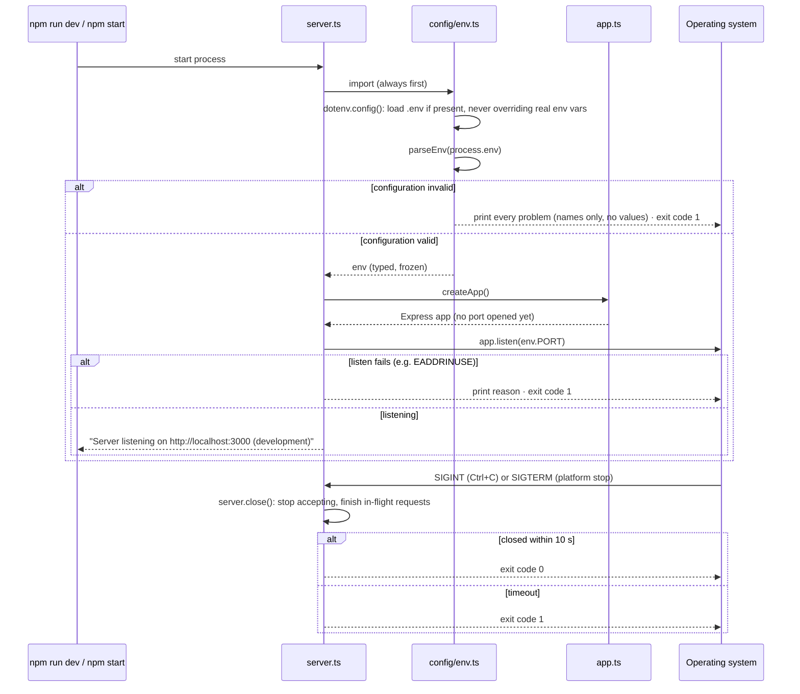

# Low-Level Design: Employee Management API

> **Status:** covers what is built (Phase 0: configuration, app factory, server lifecycle)
> plus the conventions every later module follows. Each phase adds a section for the
> module it builds, using the template in §7.

Companion documents: [High-Level Design](hld.md) · [Design principles](design-principles.md)

---

## 1. Conventions for every module

### 1.1 Files and naming

| What | Convention | Example |
|---|---|---|
| File names | kebab-case + role suffix | `employee.service.ts`, `refresh-token.repository.ts` |
| Relative imports | Include the `.ts` extension (rewritten to `.js` on build) | `import { env } from '../config/env.ts'` |
| Type-only imports | `import type` | `import type { Request } from 'express'` |
| Classes and types | PascalCase | `EmployeeService`, `Employee` |
| Functions and variables | camelCase | `findById`, `workEmail` |
| Database columns | snake_case, mapped to camelCase in the repository | `work_email` → `workEmail` |
| Permissions | `resource:action` | `employee:update` |

### 1.2 Layer contracts

| Layer | Receives | Returns | Must NOT |
|---|---|---|---|
| **Route** | n/a (wiring only) | n/a | contain logic |
| **Middleware** | `req`, `res`, `next` | calls `next()` or `next(error)` | query the database directly |
| **Controller** | validated `req` data + `req.user` | HTTP response with a response DTO | contain business rules, touch SQL, or `try/catch` just to forward errors |
| **Service** | plain values (`actor`, ids, input DTOs) | domain objects | know about `req`/`res`/status codes, or build SQL |
| **Repository** | plain values (+ optional transaction client) | domain objects or `null` | enforce business rules, or concatenate input into SQL |
| **Domain** | n/a | n/a | do I/O or import framework code |

The import restrictions in this table are enforced by `eslint.config.js` (see §6).

### 1.3 Data shapes across the layers

```text
HTTP JSON ──validate──▶ Request DTO ──▶ Service ──▶ Repository ──SQL──▶ row (snake_case)
                         (zod type)                                        │
HTTP JSON ◀──map─────── Response DTO ◀── Service ◀── Domain object ◀──map──┘
                        (fields allowed                (camelCase, no
                         for this role)                 password_hash)
```

- **Row types** never leave a repository.
- **Domain objects** never contain secrets (`passwordHash` stays inside the auth repository/service).
- **Response DTOs** list fields explicitly. Never `res.json(row)` or spread a whole object into a response.

### 1.4 Errors

- Services throw `AppError` subclasses. Repositories translate PostgreSQL errors (`23505` unique, `23503` foreign key, `23514` check) into them.
- Express 5 passes rejected promises from `async` handlers to the error handler, so controllers do not need `try/catch` wrappers.
- The error handler is the only place that chooses a status code for an error.

## 2. Startup and shutdown sequence (built)



## 3. Module: `src/config/env.ts` (built)

**Purpose:** the single source of configuration. Reads, validates and types every
environment variable once, at startup.

### Public interface

```ts
export const env: Env;                      // validated, frozen; import this everywhere
export type Env;                            // e.g. env.PORT: number, env.CORS_ORIGINS: string[]
export function parseEnv(source: Record<string, string | undefined>): Env; // pure; throws ConfigError
export class ConfigError extends Error { readonly problems: readonly string[] }
```

### Variables

| Variable | Parsed type | Rule | Used by |
|---|---|---|---|
| `NODE_ENV` | `'development' \| 'test' \| 'production'` | one of the three | error detail level, cookie `Secure` flag |
| `PORT` | `number` | integer 1–65535 | `server.ts` |
| `DATABASE_URL` | `string` | `postgres://` or `postgresql://` URL | `config/database.ts` |
| `JWT_ACCESS_SECRET` | `string` | ≥ 32 characters; not the `.env.example` placeholder | access-token signing |
| `JWT_ACCESS_TTL` | `string` | `<n>s`, `<n>m` or `<n>h`, at most 1 hour | access-token expiry |
| `JWT_ISSUER` | `string` | non-blank | JWT `iss` claim |
| `JWT_AUDIENCE` | `string` | non-blank | JWT `aud` claim |
| `REFRESH_TOKEN_TTL_DAYS` | `number` | integer 1–90 | refresh-token expiry |
| `CORS_ORIGINS` | `string[]` | comma-separated exact origins; no path, no `*` | CORS middleware |
| `RATE_LIMIT_WINDOW_MS` | `number` | integer 1,000–86,400,000 | rate-limit middleware |
| `RATE_LIMIT_MAX_REQUESTS` | `number` | integer 1–10,000 | rate-limit middleware |

### Behaviour

- **All problems at once.** Every invalid variable is listed in one run, so you do not fix them one restart at a time.
- **Names, never values.** Messages say `DATABASE_URL must be a postgresql:// connection URL`, never the URL itself (it contains a password).
- **Exit code 1** on invalid configuration, so process managers and CI see a failure.
- **`.env` is a development convenience.** Real environment variables always win, so production (no `.env` file) is configured by the platform.

### Design notes

- `parseEnv` is **pure** (input → output, no side effects), so tests can call it with any object. `loadEnv` holds the side effects (read `.env`, print, exit).
- The result is **frozen** (`Object.freeze`), so no code can change configuration at runtime.
- `process.exit(1)` lives in the config module, not in `server.ts`, because ES module imports run before the importing file's code. This is the same choice as libraries like `envalid`.

### Adding a variable

1. Add one line to `envSchema` in `env.ts`, reusing a rule helper (`requiredString`, `integer`, `secret`, …).
2. Add it, with a comment, to `.env.example`.
3. Add it to the table above.

## 4. Module: `src/app.ts` (built)

**Purpose:** build the Express application. **Interface:** `createApp(): Express`.

- **No side effects:** it does not open a port or connect to the database. Tests call `createApp()` and send requests in memory.
- **Owns middleware order** (HLD §5). Each phase inserts its middleware at its place in that list.
- **Planned change:** when services exist, it becomes `createApp(deps)`, receiving the services wired up in the composition root (HLD decision D11).

## 5. Module: `src/server.ts` (built)

**Purpose:** process entry point and lifecycle. Imports configuration first, builds the
app, listens, and shuts down on signals.

| Exit code | When |
|---|---|
| `0` | Clean shutdown after `SIGINT`/`SIGTERM` |
| `1` | Invalid configuration · port could not be opened · shutdown took over 10 s |

When the database module is added, `shutdown()` also closes the connection pool after the HTTP server.

## 6. Architecture rules enforced by ESLint (built)

| Files in | May not import | Why |
|---|---|---|
| `src/routes/` | `pg`, repositories | Routes are wiring |
| `src/middlewares/` | `pg`, repositories, controllers, routes | Go through a service |
| `src/controllers/` | `pg`, repositories, routes | Controllers call services |
| `src/services/` | `express`, `pg`, controllers, routes, middlewares | Business rules are HTTP-free |
| `src/repositories/` | `express`, services, controllers, routes, middlewares | Persistence only |
| `src/domain/` | `express`, `pg`, config, and every other layer | Pure types |
| everywhere except `src/config/env.ts` | `process.env` | One source of configuration |

## 7. Template for a new module section

Copy this when a phase adds a module:

```markdown
## N. Module: <name>

**Purpose:** one sentence.

### Public interface
Function signatures of the service and repository (inputs, outputs, errors thrown).

### Main flow
A sequence diagram for the most important operation.

### Data
Tables and columns read or written; which operations run in one transaction.

### Rules
Business rules and validation, each with the error it produces (type + HTTP status).

### Security
Permission required, ownership/scope rule, fields each role may read and write, what is audited.

### Tests
Which items of the assignment's test checklist this module covers.
```
